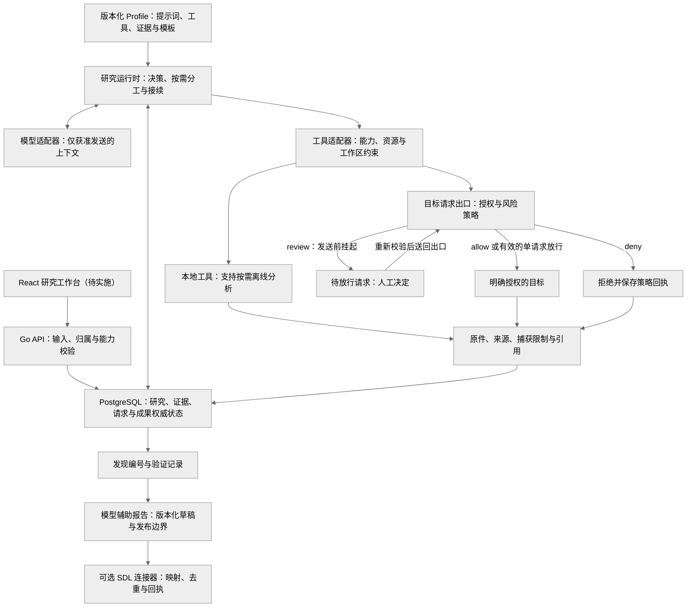

# 通用研究内核、流量控制与扩展边界

## 当前架构决定（2026-11-13，覆盖下文旧目标）

**2026-11-14有界UI质量增量：** 仅正式原生UI覆盖调整配置Dialog/文字可读性/必要DOM语义，复用已验binary，无Go或Harness/协议变化；一次新UI离线构建及目标页面真实交互/主看图完成，剩余Workflow对比度/待人工核验项明确保留。最新预览与未验范围见[UI质量验收](../native/ui/UI-QUALITY-ACCEPTANCE.md)与STATUS0.62，不把历史“预览保留”当当前端口存活。

**2026-11-14最新状态补充，覆盖下文各技术切片当时“UI未接”的描述：** 已完成原生页面配置→节点当前报告→创建/发送→真实工具结果的本机受控用户链，正式UI覆盖、原生模式标志和离线增量构建接通；主实际查看4个页面状态，13持久/12持久实时事件及真正completed通过。不是完整业务迁移/生产研究；工具辅助UI审核仍有可访问性/展示待修项，也排除了审核工具自身WebSocket包装造成的误导。准确范围、当前预览与未验项见[用户流程验收](../native/ui/CONFIG-EXECUTION-ACCEPTANCE.md)及STATUS最新。

用户已明确：**全部基于cyber-harness的Harness架构实现既有产品设计，能复用的直接复用，额外功能通过其扩展机制实现，不再自建另一套Harness。** Cyber是平台主体底座，不是可选执行插件；旧Snapshot→Decision循环不得继续作为新功能的研究引擎，也不在其上套Cyber形成两套运行循环。运行、原生事件/会话、工具/终端/流量与适合的原生UI均纳入直接复用；旧API/表结构/Ant组合不是必须保留的设计前提。

完整约束及下一设计片见[已确定的Cyber底座](cyber-harness-foundation.md)。接下来冻结“需求→原生能力→扩展点→新增业务功能”的映射、状态归属与最小实施契约，不再讨论是否采用Cyber。授权、证据保真、候选/确认与unknown不重放等业务要求保留；是否已由上游实现必须实测，不能仅凭可扩展宣传认定。

**完整业务迁移尚未完成；独立 `native/` 已开始基于该底座实现。** H1原生会话/固定工具、H2-A原生Web宿主与H2-B原生Web→节点→工具→Hub事件链已完成本机受控验证；H3-A2原生UI完整构建及静态资源HTTP/鉴权接线通过。H3-B进一步通过真实浏览器原生登录、空会话列表/侧栏收展和Agents空抽屉开关，主已查看7阶段截图；空Hub缺配置400/IOA404及页面红提示仍存在，不能称全站/视觉认可。2026-11-14 H3-C已进一步验证Cyber原生UI→显式本机fixture节点→固定工具→真实页面结果/13持久与12实时事件，未改产品源码；仅受控固定链，生产模型/目标授权/业务迁移和完整恢复仍未完成，见[执行链验收](../native/ui/EXECUTION-ACCEPTANCE.md)。随后H4-A通过原生模型配置持久化、原生Config RPC与真实CLI验收：私有唯一FileConfigStore、活动配置选择/秘密保留、明确拒绝probe，不创建Provider/节点，见[配置子片](../native/CONFIG.md)。H4-B进一步复用原生DialFactory和OpenAI Provider，通过单一本机IP:port的连接约束、无隐式probe构造/发布、非流/SSE及越界重定向专项，见[模型传输子片](../native/MODEL-TRANSPORT.md)。H4-C已将原生配置/节点接入该受控网络Provider，实际两次模型SSE、固定工具与14持久事件/自然完成、配置应用失败后回切及资源关闭通过；仅显式本机受控链，尚无原生UI适配、真实研究效果、业务迁移或通用目标出口，见[模型节点子片](../native/MODEL-NODE.md)。真实状态以[STATUS](STATUS.md)、[native入口](../native/README.md)及[浏览器验收](../native/ui/BROWSER-ACCEPTANCE.md)为准。下文A3/E1、Go薄循环、数据库与框架选型等内容保留为旧设计/历史实现背景，冲突的目标不再执行；旧API只说明旧业务实现，不能替代新底座协议。尚未迁移旧业务数据或部署。

日期：2026-11-10。**架构基线 A3（目标）+ G0 窄片实现增量 + Web/API 设计补充**；实际验证见 [STATUS](STATUS.md)，当前 API 见 [api 第1–4节](api.md#1-当前-http-契约)。G0 默认工具/联网、轻量 HTTP 策略与共享镜像配方属于上一实现轮次，新 runtime 镜像未构建运行。2026-11-11 完成获准的可靠启动后端首轮：新增原子任务/初始方向/启动回执和版本化迁移，复用原研究循环，不引入框架或新依赖；仅受控本地验收，未部署或操作业务库。

**2026-11-11阶段调整：** 首版暂不要求新增请求风险控制/审批和真实外部平台对接；下文相关目标保留为后续，不再作为首版本地流量/发现/复测的强制前置，现有保护与授权边界不变。目标流量必须记录；逐轮模型输入/返回原文记录改为可开关，开启时提供读取接口。用户接受身份/业务前提、上下文选择、有限工作区、持久增量展示与有界恢复的补齐方向，并强调先复用成熟组件。新增文件夹式 skill 资料库和运行时版本选择；禁止行为提示词可开关，与未来实际请求审批同属测试安全，但软约束关闭不撤销授权/现有程序保护。详细语义见[研究配置补充](research-configuration.md)。保持稳定优先、模型自主探索，不强制完整覆盖；主研究模式加按需独立验证/复测，不建强制覆盖账本和结束门槛，具体契约/组件仍待冻结，见 [研究引擎E1](research-engine-design.md)、[确认稿D1](product-confirmation.md)。

## 1. 架构立场与当前底座

目标：**Go 控制面 + PostgreSQL 权威状态 + 可替换研究运行时 + 版本化场景配置 + 受控工具/请求出口 + 证据、发现与报告适配器。**

采用共享研究上下文、持久问题、证据驱动与按需协作的思想，不绑定“黑板架构”名称，不设固定多层 Agent 组织，也不为每种场景再建一套应用。先模块化单体、单控制面；只有实际隔离/容量需求出现才拆服务。

| 方面 | 当前代码 | A3 目标，不是已实现声明 |
|---|---|---|
| 研究运行时 | Go 薄循环；一次 Snapshot → 一次 JSON Decision | 经受控选型验证后保留薄循环或接可替换 Go Agent 框架 |
| 并发 | 研究与动作 worker 各自有界 | 按需分工、依赖/交回、项目总预算与业务资源冲突约束 |
| `delegate` | 新建 Thread，auto_run=false；无结构化父子汇合 | 调度器按授权与预算安排独立任务，不逐个审批探索意图 |
| 研究上下文 | 当前方向的观察、动作、尝试 | 项目内相关证据与问题的受控共享、检索、引用与版本 |
| 执行审批 | G0：新命令默认 approved；HTTP 命中明确破坏信号才 pending；历史 pending 不重评 | 完整请求/策略/放行契约；不是一个工具放行后全部流量免检 |
| 网络 | 控制面 HTTP 保留 origin/DNS 校验；命令默认 bridge，可设 none；直连未拦截或强制 origin | 保持工具/联网默认可用，补齐不可绕过的原生请求出口 |
| 成果 | 观察/动作结果，无 Finding/Report | 稳定编号、实质验证、模型报告、SDL 适配 |

G0 的 `request-signals-v1` 只识别 DELETE 与 URL/path/query/body/JSON、method override 中的 delete/remove 等明确破坏信号；未命中默认放行，未知不一律待审，不能据此断言请求安全。`approved` 表示策略或人工放行；仅 pending 的研究尝试进入 waiting_approval。请求哈希与策略理由同事务保存，初始理由还写入 `action.proposed` 事件，人工 `decision_reason` 可覆盖；不改 schema，也不自动升级旧 pending。

打包配方只生成 `wscyber/runtime:local`，包含宿主构建的 Linux/CGO=0 Go 程序、web 与已确认工具层，各场景共用。PG 保持独立持久服务。宿主 `make run` 保留；容器控制面执行命令另需 Docker CLI/socket 权限，尚未验证或提供完整容器部署。

当前 `internal/model` 的官方 SDK 只负责模型请求，不是 Agent 框架；`internal/research` 承担编排。具体选型先看 [components](components.md)，不把候选框架写成已采用依赖。

## 2. 模块与信任边界（目标）

下图是完整目标职责，不表示每个框都是独立服务。现有模块与新增职责混合展示，新增职责均需单独实施。2026-11-11已实现React可靠创建/提交核对及最小只读研究/证据窄片，通过本地可见浏览器交互验收，产物隔离至 `web/dist-react`、未切换服务；图中完整研究工作台及成果/流量能力仍待后续实施。

程序授权、数据库状态、执行结果分别有明确权威；模型、目标内容、工具输出、外部文档均不能扩大权限。模型供应商与 SDL 的数据传递各有单独配置和材料边界，不走“目标允许 origin”来隐式授权。

当前证据字节保存在 ActionResult 中；没有独立对象存储或“记忆平台”。先复用 PostgreSQL 保存元数据与引用，按真实材料规模决定是否接对象存储/检索组件，不预设向量数据库是必要条件。

## 3. 场景 Profile 与能力契约

Profile 是版本化配置，不是另一个超级用户，也不是任意可执行插件。建议包含：

- 模式标识/版本、目标模板、可信系统提示词与任务约定。
- 可申请的工具能力、输入/输出 schema、上下文选择方式、模型路由建议。
- 证据与验证准则、结果类型、报告模板和评测样例。
- 默认资源/时间/步数预算及风险提示；**实际授权、预算上限与策略由控制面约束**。

漏洞挖掘、代码审计、CTF、内部演练共用内核；通过 profile 与适配器扩展语义。各场景默认共享镜像已有工具与联网能力，不设逐场景工具名单；Profile 规范方法而非授予权限，模式切换不得扩大旧工作的目标授权或预算。profile/提示词/工具版本记录到尝试与报告来源，便于复核。

工具适配契约目标是声明网络需求、读写范围、副作用、输出类型、异步/取消/恢复能力；当前命令直接使用镜像内已有工具，不因缺少注册名单就逐条禁用或送审，也不把不存在的工具冒充可用。源码、CTF 附件及依赖脚本是不可信输入；构建/分析在独立工作区和沙箱中执行，不挂宿主秘密或把下载内容作为控制面代码运行。

当前授权只有精确 HTTP(S) origins。仓库/commit/文件范围、身份/会话、演练时窗与停止条件属于待设计的类型化授权扩展；不能把提示词或一个字符串列表冒充所有协议与资源的权限模型。

## 4. 研究调度与共享上下文

通用循环是选择问题 → 读取相关材料 → 有限决策 → 使用获准工具/记录观察 → 保存材料 → 重判；不是硬编码“侦察→扫描→利用→报告”的固定流水线。

**任务启动首轮（已实现后端）**：`POST /api/explorations` 接收“目标／已知信息”“希望达到的目标”和单独明确的 origins，要求提交键；在同一 PG 事务保存 Mission、一个 ready/auto_run=true 的初始 Thread、启动事件与 operations 成功回执。现有 ClaimThread 再认领为实际 Attempt，不另设启动队列。202只表示接收成功；同键回放不修改实时状态，GET operations 用于失联核对。旧 Mission/Thread 创建语义保留；React最小入口已接入并通过受控本地交互验收，未切换服务。ARTEX 固定版本研究及提示词职责建议见 [research-start-and-prompts](research-start-and-prompts.md)；借鉴目标/方向/证据回流，不引入固定多角色组织或第二套状态权威。

1. **问题长寿命，尝试短寿命。** 失败和预算耗尽保留未决问题，不当作反证或已证明安全。
2. **先单执行者，必要时分工。** 独立、互补且不争用业务状态才并行；同账号/记录的写操作、共享 session 等通过业务资源标签与调度约束处理，不能只靠提示词。检查机制尚未实现。
3. **子工作有边界和交回。** 保存来源问题、输入证据引用、范围、能力、预算与返回目标；结果可消费，不靠把父 ID 拼入自然语言。总预算不能因无限 delegate 放大，默认有限扇出/深度。
4. **共享的是证据和问题，不是全部聊天。** 按项目权限、任务相关性和材料分级选择上下文，保留支持/反证与来源。跨项目默认不共享。
5. **摘要是派生物。** 原件不可被压缩替代；超出上下文时检索/选择并显式标记未读范围，不静默删除反证。当前超过256KiB直接报错的行为仍是现状，不宣称已有检索。
6. **等待是持久状态。** 等待请求放行/外部任务结果时不反复调用模型；其他独立问题可继续。运行时 checkpoint 只能恢复计算，不能自行重放可能已发送的请求。

无论使用 Eino/ADK 或薄循环，业务状态仍由 PostgreSQL 权威记录。框架 session/checkpoint 可作可重建运行时数据，不能与业务状态形成两套互相矛盾的授权、执行或恢复真相。

## 5. 请求级流量门禁（目标）

### 检查对象与策略

检查的是工具最终准备发送的具体请求，不是探索计划，也不是工具调用名称。一次工具调用可以对应多个请求，每次重定向、派生请求和重试均需重新经过出口。当前 HTTP 不跟随重定向、不自动重试，新增支持不得削弱这一边界。

| 决策 | 行为 | 持久记录 |
|---|---|---|
| allow | 执行前复核硬授权与有效策略后发送 | 请求引用、策略版本、理由与执行结果 |
| review | 命中需人工处理的规则时暂不发送，保存不可变待审请求 | 命中原因、上下文引用、有效期与人工决定 |
| deny | 不发送，不提供绕过授权的批准入口 | 拒绝原因；不是目标 HTTP 响应 |

结合规范化 URL/方法、query、body、请求头、身份/会话和业务语义判断风险。GET `/delete`、POST RPC/GraphQL 中的删除语义不能靠方法白名单漏过；不承诺能完美识别全部业务副作用。不确定性是否待审须由明确规则决定，不能把所有未识别请求一律送审；G0 仅按明确破坏信号分流，未命中默认放行，不覆盖完整业务语义。模型建议是辅助信号，不是最终批准者；策略基础设施不可用不得悄悄绕过检查。

### 放行与挂起

放行绑定请求指纹、授权/策略版本、执行身份/上下文及有效期，限定一次发送许可；不是某个路径/工具的无限许可证。请求或关键上下文变化重新评估；hard deny 不因人工决定变为 allow。展示时遮蔽秘密，但不得让关键参数不可见而盲批。

持久保存待审请求与 continuation，释放研究计算槽；批准后复核有效性再调度。平台代发 HTTP 可以先完成这条路径。原生浏览器/工具的 socket、进程和超时如何暂停恢复，须由适配器单独证明；不能假称等待时所有底层资源自动释放，也不能伪造目标403来迫使工具重跑整项任务。

### 工具网络边界

G0 新命令默认放行，Docker/runc 默认 `bridge`，可显式配置 `WSCYBER_SANDBOX_NETWORK=none`。仍保留非 root、只读根文件系统、无宿主 socket/挂载/秘密以及输出、时间和资源预算；`/tmp` 扩为512MiB并取消 noexec，支持工具工作文件。**原生工具直连未拦截，也未强制 origin 范围；平台代发 HTTP 的门禁不能约束这些流量。** 默认可联网不是任意目标授权。

完整出口能力的目标是让网络工具强制经出口，阻止直连/备用协议绕过；这仍未实现，不能写成 G0 的现有保证。优先复用成熟 proxy/MITM 组件，但 HTTP_PROXY 本身不是不可绕过保证。TLS 检查、pinning、mTLS、WebSocket、UDP/QUIC 各自声明支持/拒绝，不宣称全协议捕获。沙箱隔离器和流量代理解决不同问题，不能互相代替。

## 6. 持久化、恢复与兼容

现有状态/接口以 [api](api.md) 第1–4节为准。G0 复用旧 Action：新 HTTP 的 pending 表示命中启发式信号，历史 pending 仍可能是旧全审批动作，不能全部改名为“危险请求”；approved 不一定来自人工。G1 仍需冻结 Tool action、Outbound request、Policy decision、人工放行与执行结果的关系，尤其一个工具多请求；G0 没有实现独立请求模型、完整策略版本/有效期或自动迁移。

继续保留以下不变量：

- 执行前持久认领，完成后原子保存结果、观察及状态；观察已保存不因后续尝试收尾失败而丢弃。
- 发送开始而结果不明则 outcome_unknown，不当作失败自动重试。一次许可不等于外部恰好一次。
- 暂停阻止新派发，不假装取消在途工作；当前 resume 会允许原 approved（策略或人工放行）派发，前端必须显示真实影响。
- 重启保留研究问题、待审请求和原件；对可能已发送请求先核对，不让框架恢复重新调用执行工具。
- 浏览器写入失联、请求门禁等待、目标执行未知、报告生成失败、SDL 投递未知是不同状态，不能共用一个“重试”。
- 可靠启动端点已有幂等键/提交回执，旧 POST 的全量可靠提交仍待补齐；请求哈希不是提交幂等键。版本化迁移已承接已知 G0 基线，不重建业务库；升级与回退约定见 [database-migrations](database-migrations.md)。

当前研究/执行 worker 各使用 MaxParallel，不是全系统总上限；现有累计方向步数不是项目 token/费用预算。新增协调与成本控制不能被写成已有能力。

## 7. 发现、报告与 SDL

发现编号由平台生成，不交给模型自由生成。候选与确认分开，验证记录包含支持、反证、前提及证据引用；代码位置绑定仓库版本，动态证据绑定请求/响应与身份上下文。

报告是固定发现/证据版本的派生物。模型自动生成草稿、解释影响和建议修复；确定性程序核验引用、必填字段与编号，缺材料明确标记。正式发布/投递单独授权，不能以“生成成功”冒充“已验证/已发布/SDL 已接收”。

SDL 通过可替换连接器适配，不假设内部平台就是 DefectDojo。保存本地编号与远端 ID 映射、字段/状态映射、payload 版本、投递回执与冲突；超时先核对，不能重复创建漏洞。详见 [findings-and-reporting](findings-and-reporting.md)。

### Web/API 产品功能补充（已确认需求，设计未冻结、未实现）

用户已确认首版主场景为 Web/API 漏洞挖掘；产品需包含类 Burp 的请求/响应流量面板、探索图谱、逐漏洞发现时间线、关联可复制流量的简洁漏洞详情，以及逐漏洞复测/报告和外部双向复测对接，不要求第一步全部完成。

- **统一事实与多种视图**：具体流量、研究/验证活动、发现及复测使用稳定身份和结构化来源关系。图谱显示关系，时间线显示已发生事件，漏洞详情显示精简结论与复现证据；均从同一权威事实读取，不分别让模型生成互不一致的叙事。
- **不为图谱另建权威数据库**：先由 PostgreSQL 保存关系与事件；图形组件只是展示适配器，不据可视化需求直接引入图数据库。节点/边、事件类型、分页/聚合和组件选型在相应切片冻结。
- **复测属于新的受控执行**：绑定原漏洞版本、本次环境/身份及有效授权，保存新流量、结论与独立报告。复测不覆盖原发现；无法访问或未复现不能自动等于修复通过，也不允许盲目重放旧请求。
- **外部任务与结果传输分离**：入站适配器鉴权、去重并匹配本地授权后保存复测任务，外部漏洞材料不授予权限；出站适配器按约定格式投递固定版本结果，记录回执。任务完成与结果送达分开，重试投递不得重新执行目标测试；不接受任意入站回调地址作为授权目的地。
- 当前没有这些新增实体/API，也没有原生全流量捕获。图谱/时间线不要求先完成运行时多 Agent；复测连接器不预设与 SDL 为同一系统。功能与交互详见 [findings-and-reporting](findings-and-reporting.md)、[frontend-design](frontend-design.md)。

## 8. 先复用、再冻结契约、最后实施

1. 对运行时框架、请求出口、代码/安全工具、报告模板/渲染、SDL 标准与连接器分别选型，不要求一个轮子包办全部。
2. 候选应通过有界工具调用、发送前拦截、持久等待、unknown 不重放、证据来源与授权边界的小型实验，再决定采用/保留自研；G0 未引入 Eino、ADK 或代理候选，上一设计轮次的公开资料核验不等于采用验证。
3. 不为了扩展性预建插件市场、消息中台、多节点沙箱、向量库或第二记忆平台。接口先满足两个真实不同场景，再检验是否足够通用。
4. 正式前端跟随真实能力与新语义分片交付，不把旧“所有动作审批”工作面当目标。具体范围见 [roadmap](roadmap.md)。

图仍为中性主题的 Mermaid 目标职责图，文字标识所有职责，不依赖颜色；G0 只调整一处节点文字，不新增图或改变样式。本轮未安装/运行渲染器；只做文档静态检查，不声称渲染与视觉验收。
